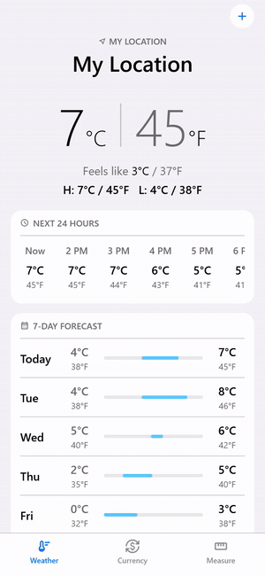
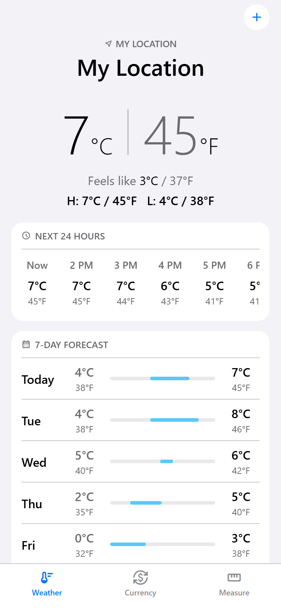
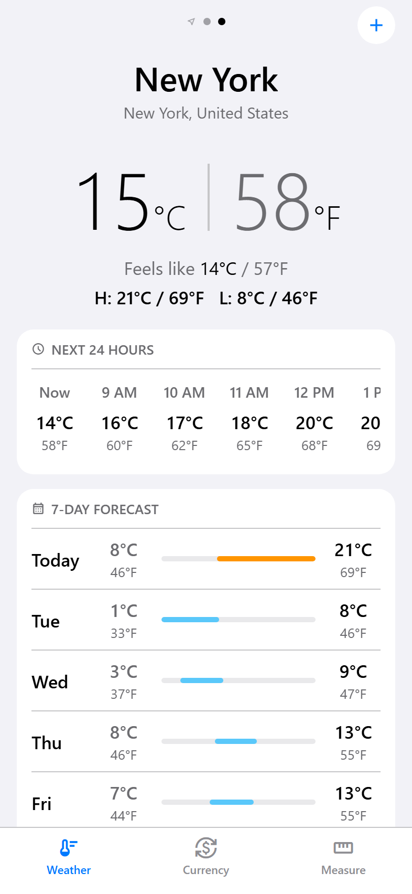
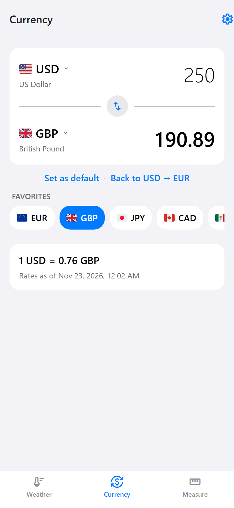
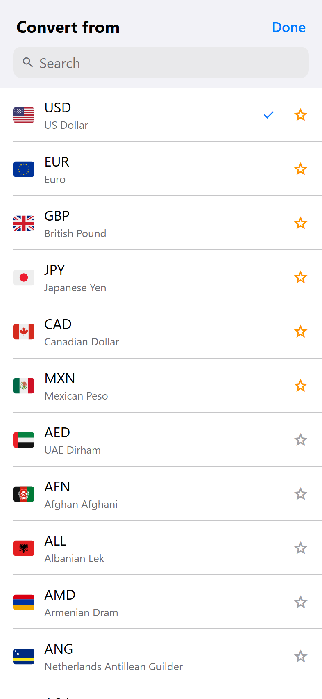
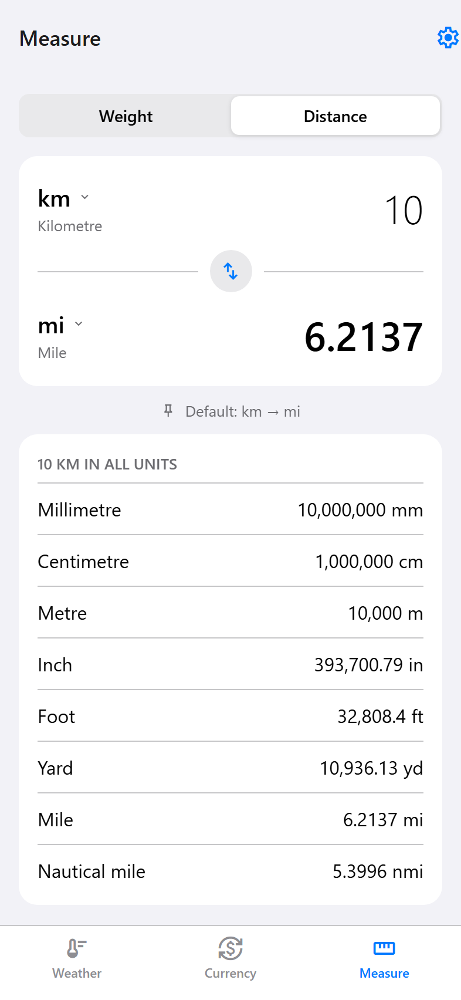

# Convert

An iPhone app to use instead of Apple's Weather app. It shows the temperature in °C and °F at the same time, and has two more tabs for converting currency and units.

**▶ Try it: [web demo](https://masonholland.github.io/Convert/)**, or the real thing on your iPhone with **Expo Go** ([steps below](#run-it-on-your-phone), no Mac needed). The web demo runs in any browser; on a computer it's shown at iPhone size.

<p align="center">
  
</p>
<p align="center"><sub><a href="docs/media/demo.mp4">Full-quality video (MP4)</a></sub></p>

## The problem

Weather apps show one temperature unit at a time, so if you need both °C and °F you're either changing settings or converting in your head. Currency and unit converters are usually separate apps or websites, and most of them don't remember the currencies you use or work offline.

## The solution

Three tabs: **Weather**, **Currency** and **Measure**.

| Feature | What it does |
|---|---|
| **Weather** | Current temperature in °C and °F, feels-like, and today's high and low. Below that, the next 24 hours and a 7-day list where a bar shows each day's range against the whole week. |
| **Locations** | Your current location, plus any cities you add with **+**. Swipe between them; dots at the top show which one you're on. Press and hold a city's name to remove it. |
| **Currency** | About 160 currencies. Type an amount, tap a currency code to change it (the picker is searchable and shows flags), or tap ⇅ to swap. Shows the rate, e.g. `1 USD = 0.91 EUR`, and when it was updated. |
| **Favorites & defaults** | Starred currencies go to the top of the picker and show as chips under the converter. The tab opens on your default pair, and a **Set as default** button appears when you change it. |
| **Measure** | Weight (mg, g, kg, t, oz, lb, st) and distance (mm, cm, m, km, in, ft, yd, mi, nmi). Any unit to any other, with a table of the amount in every unit. Each has its own default pair, kg → lb and km → mi to start. |
| **Offline** | The last forecast and rates are saved and shown, marked "Offline". Measure doesn't need a connection at all. |

It uses the iOS tab bar, SF Symbols, large titles, sheet pickers and haptics, and follows light/dark mode. This version is built with Expo / React Native. A fully native App Store build is planned.

## Screenshots

<table>
  <tr>
    <td align="center"><br><sub>Weather</sub></td>
    <td align="center"><br><sub>A saved city</sub></td>
    <td align="center"><br><sub>Currency</sub></td>
  </tr>
  <tr>
    <td align="center"><br><sub>Currency picker</sub></td>
    <td align="center"><br><sub>Measure</sub></td>
    <td></td>
  </tr>
</table>

<sub>Taken from the web demo in a phone-sized browser.</sub>

## Tech stack

| Area | Choice |
|---|---|
| Framework | [Expo](https://expo.dev) SDK 58 · React Native 0.88 · React 19.3 |
| Language | [TypeScript](https://www.typescriptlang.org/) 6 (strict) |
| Navigation | [Expo Router](https://docs.expo.dev/router/introduction/) (file-based routes). Native tabs (`expo-router/native-tabs`) give the real iOS tab bar, and each tab has its own native stack with a large-title header |
| Icons | `expo-symbols`: SF Symbols on iOS, Material Symbols on Android and web |
| State | [Zustand](https://github.com/pmndrs/zustand) 5 with the `persist` middleware |
| Storage | `@react-native-async-storage/async-storage` |
| Location | `expo-location` (only while the app is in use, plus reverse geocoding for the city name) |
| Haptics | `expo-haptics` |
| Unit tests | Jest 30 with `jest-expo` |
| Lint | ESLint 9 with `eslint-config-expo` |
| README media | [Playwright](https://playwright.dev/) and [ffmpeg-static](https://github.com/eugeneware/ffmpeg-static) (`npm run media`) |

### Data sources

Both are free and need no API key.

| Data | Service | Endpoint |
|---|---|---|
| Forecast | [Open-Meteo](https://open-meteo.com/) | `api.open-meteo.com/v1/forecast` |
| City search | Open-Meteo Geocoding | `geocoding-api.open-meteo.com/v1/search` |
| Exchange rates | [ExchangeRate-API (open access)](https://www.exchangerate-api.com/docs/free) | `open.er-api.com/v6/latest/USD` |

Temperatures are downloaded in °C and converted to °F on the phone. Rates are quoted against USD, so any pair converts as `amount / rate[from] × rate[to]`.

## Run it locally

### Prerequisites

- **[Node.js](https://nodejs.org/) LTS** (includes npm). This was built with Node 26.
- **[Git](https://git-scm.com/)** to download the code.
- **Expo Go** on your iPhone (App Store) or Android phone (Play Store).
- The computer and the phone on the same Wi-Fi network.

### 1. Download

```bash
git clone https://github.com/MasonHolland/Convert.git
cd Convert
```

Without Git, download the ZIP from the [repository page](https://github.com/MasonHolland/Convert) (**Code → Download ZIP**), unzip it, and open a terminal in that folder.

### 2. Install dependencies

```bash
npm install
```

### 3. Start the development server

```bash
npx expo start
```

### Run it on your phone

1. **iPhone:** open the Camera app and scan the QR code in the terminal. It opens in Expo Go.
   **Android:** scan the QR code from inside Expo Go.
2. Allow location access when asked, so the Weather tab can show where you are.

If the phone can't connect (a guest or office network, for example), use `npx expo start --tunnel`.

### In a browser

`npm run web`, then open the URL it prints. On Windows, flags show as letters.

### Other commands

| Command | What it does |
|---|---|
| `npm start` | Start the Expo dev server |
| `npm run web` | Run in a browser |
| `npm test` | Run the unit tests (Jest) |
| `npm run typecheck` | Check TypeScript types |
| `npm run lint` | Run ESLint |
| `npm run media` | Re-record the screenshots and demo video in `docs/media/` (see below) |
| `npx expo-doctor` | Check for dependency and configuration problems |

## Web demo

The web build is a demo of the iPhone app. Every push to `master` runs the tests, exports it with `npx expo export --platform web` and publishes it to GitHub Pages (`.github/workflows/deploy.yml`). `app.json` sets `experiments.baseUrl` to `/Convert` so it works from that sub-path.

A few files only exist for the web build, and iOS never loads them:

- `app/(tabs)/_layout.web.tsx`: a regular bottom tab bar, since native tabs render as a bar at the top on web.
- `src/components/WebDemo.web.tsx`: on a computer, shows the app at iPhone size in a frame with a short description; in a phone browser, a small "web demo" banner you can close.
- `components/useColorScheme.web.ts`: follows the browser's light/dark setting.

## Building the iOS app

Expo's cloud service, EAS, can build and sign the iOS app without a Mac:

```bash
npx eas-cli@latest build -p ios      # needs an Apple Developer account
npx eas-cli@latest submit -p ios     # upload to TestFlight / App Store
```

Before the first store build, change `ios.bundleIdentifier` in `app.json` (currently `com.convert.app`) to an identifier you own.

## Screenshots and demo video

`npm run media` records everything in `docs/media/` with Playwright, using the web build in a phone-sized Chromium (without the demo banner). It starts `expo start --web` on port 8081 if it isn't already running, and writes PNG screenshots, `demo.mp4`, `demo.gif` (used above) and `demo-poster.jpg`. Use `npm run media -- --only shots` or `--only video` to do half. The first time, run `npx playwright install chromium`.

The weather and rates are live, with the location set to London. The script loads a flag-emoji font, because Windows has none. The steps are in `scripts/media/capture.mjs`.

## Project structure

```
app/                          Screens (Expo Router: every file is a route)
  _layout.tsx                 Root stack and theme; waits for saved data to load
  (tabs)/_layout.tsx          Native bottom tabs
  (tabs)/(weather)/index.tsx  Weather tab: location pages you swipe between
  (tabs)/currency/index.tsx   Currency tab
  (tabs)/measure/index.tsx    Measure tab
  city-search.tsx             Modal: search for and add a city
  settings/currency.tsx       Modal: default currency pair and favorites
  settings/measure.tsx        Modal: default unit pairs
src/
  api/weather.ts              Open-Meteo forecast + geocoding clients
  api/rates.ts                Exchange-rate client
  lib/temperature.ts          °C ↔ °F helpers
  lib/units.ts                Unit list (each with a factor to grams or metres) and conversion
  lib/currency.ts             Currency conversion, names and flags
  lib/format.ts               Input parsing and number formatting
  lib/time.ts                 Formats each location's local times
  hooks/                      useCurrentPlace, useForecast, useRates
  store/useAppStore.ts        Saved state (cities, defaults, favorites, cached data)
  components/                 Shared UI (ConverterCard, PickerSheet, DualTemp, WeatherPage, WebDemo …)
components/, constants/       Theme helpers and the iOS-style colors
__tests__/                    Unit tests
.github/workflows/deploy.yml  Publishes the web demo to GitHub Pages
scripts/media/                Records the README screenshots and video
docs/media/                   Screenshots and demo video used in this README
```

### Adding a measurement unit

Add an entry to `UNITS` in `src/lib/units.ts`. Its `factor` is how many base units (grams for weight, metres for distance) one of the new unit equals. The pickers, the "all units" table and the conversions pick it up automatically.

## Good to know

- Location is only used while the app is open. If you deny it, you can still add cities by hand, and there's a shortcut to iOS Settings.
- Pull down on the Weather tab to refresh.
- Amounts can be typed as `12.5` or `12,5`.
- Saved cities, defaults, favorites, rates and forecasts are all stored on the phone.

## License

<!--
TODO: Choose a license before sharing this code publicly.
The Expo template's MIT LICENSE (which named Expo as copyright holder) was removed.
Options: MIT or Apache-2.0 (permissive), or keep no license (all rights reserved).
Pick one at https://choosealicense.com and add a LICENSE file with your name.
-->

No license has been chosen yet. All rights reserved.
